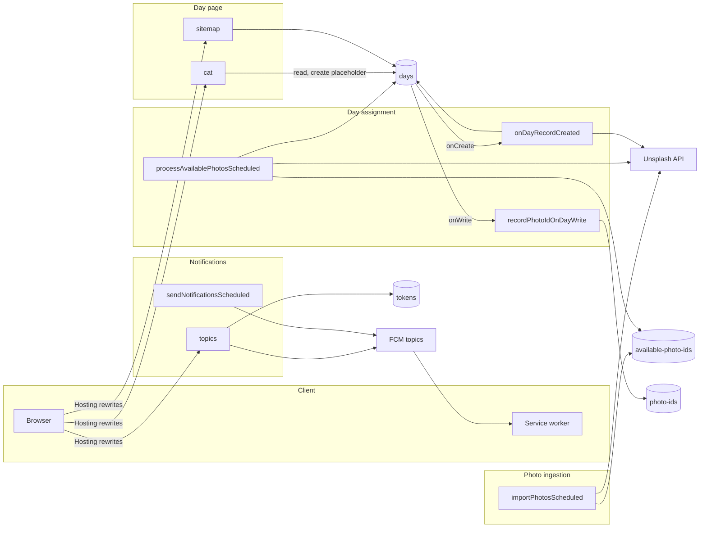

# Daily Cat: Architecture Overview

Daily Cat ([daily.cat](https://daily.cat)) shows one cat photo from Unsplash for each calendar day (UTC). Every page is rendered on the server by Firebase Cloud Functions. A small browser bundle adds opt-in daily push notifications.

This document is the entry point. Each slice of the system is described in its own spec in this directory.

## Slices

| Slice                                 | Responsibility                                                             | Functions                                                                          | Data it owns                   |
| ------------------------------------- | -------------------------------------------------------------------------- | ---------------------------------------------------------------------------------- | ------------------------------ |
| [Photo ingestion](photo-ingestion.md) | Search Unsplash and queue unused photo IDs                                 | `importPhotosScheduled`                                                            | `available-photo-ids`          |
| [Day assignment](day-assignment.md)   | Give each day a photo, and never reuse a photo                             | `onDayRecordCreated`, `processAvailablePhotosScheduled`, `recordPhotoIdOnDayWrite` | `days`, `photo-ids`            |
| [Day page](day-page.md)               | Server-rendered day pages, navigation, sharing, and the sitemap            | `cat`, `sitemap`                                                                   | — (creates placeholder `days`) |
| [Notifications](notifications.md)     | Web push opt-in and opt-out, and the daily send                            | `topics`, `sendNotificationsScheduled`                                             | `tokens`                       |
| [Platform](platform.md)               | Hosting, Firestore rules, config, secrets, build, local development, CI/CD | —                                                                                  | `config/config`                |

## System diagram

## How the slices connect

| From → To                        | Through                                        | Contract                                                                                                                          |
| -------------------------------- | ---------------------------------------------- | --------------------------------------------------------------------------------------------------------------------------------- |
| Day page → Day assignment        | `createNewDayRecord()`                         | Creates `days/{date}` with `status: 'created'` and `photo: null`, only if the day has no record. This fires `onDayRecordCreated`. |
| Day assignment → Day page        | The `days/{date}` record                       | A `completed` record has a full `UnsplashPhoto`. The processing page polls until it appears.                                      |
| Photo ingestion → Day assignment | `available-photo-ids`                          | Queued IDs are candidates only. Day assignment checks them against `photo-ids` again before using them.                           |
| Photo ingestion ↔ Day assignment | `config.lastPage`                              | A shared Unsplash search page cursor. Both move it only through Platform's `advanceLastPage()`, which never moves it backwards.   |
| Day page → Notifications         | `#notifications-button`, `#toast`, `/index.js` | The server renders the markup. The client bundle adds behavior.                                                                   |

## Cross-cutting rules

- **All dates are in UTC.** That includes "today", day IDs, schedules, and `hour-HH` topics.
- **Only Cloud Functions touch Firestore.** The rules deny all client access.
- **Every function needs `config/config`.** If the document is missing or fails its schema, every page and job fails. See [Platform](platform.md).
- **Each photo should be used at most once.** This is enforced after the fact through `photo-ids`, so it is best effort. See [Day assignment](day-assignment.md).
- **Unsplash links carry attribution parameters** (`utm_source=daily.cat&utm_medium=referral`).

## Repository map

| Path                                                                    | Slice                       |
| ----------------------------------------------------------------------- | --------------------------- |
| `functions/src/ingestion/`                                              | Photo ingestion             |
| `functions/src/assignment/`                                             | Day assignment              |
| `functions/src/day-page/`                                               | Day page                    |
| `functions/src/notifications/`                                          | Notifications (server side) |
| `functions/src/platform/`                                               | Platform                    |
| `src/`                                                                  | Notifications (client side) |
| `assets/`                                                               | Day page (static files)     |
| `firebase.json`, `firestore.*`, `rollup.config.js`, `seed/`, `.github/` | Platform                    |

## Milestones

The functions code is organized by layer (`api/`, `storage/`, `tasks/`, `types/`), and slices reach into each other's files. For example, Photo ingestion imports the Unsplash secret from Day assignment's `photo-processor.ts`, and the sitemap queries `days` directly. These milestones move to one folder per slice, in steps that can each ship alone.

Target layout under `functions/src/`:

| Folder           | Slice           | Exports from its `index.ts`                                                                         |
| ---------------- | --------------- | --------------------------------------------------------------------------------------------------- |
| `platform/`      | Platform        | Firebase app, `getConfig()`, `updateConfig()`, the `UNSPLASH_CLIENT_ID` secret                      |
| `ingestion/`     | Photo ingestion | Unsplash `list()` and `get()`, Unsplash types and errors, queue reads and deletes                   |
| `assignment/`    | Day assignment  | `getPhotoForDate()`, `createNewDayRecord()`, a completed-days query, `isPhotoIdUsed()`, `DayRecord` |
| `day-page/`      | Day page        | Its functions only                                                                                  |
| `notifications/` | Notifications   | Its functions only                                                                                  |

`functions/src/index.ts` keeps re-exporting the eight functions, now from the slice folders. The client code in `src/` stays where it is, because it is a separate Rollup build.

Rules for every milestone:

- Ship it as its own PR, with `npm run build`, `npm test`, and `npm test --prefix functions` passing.
- Never rename an exported function. Firebase deploys a rename as a delete plus a create, so triggers and schedules are dropped during the deploy.
- Move files with `git mv`, and move each test along with its source.
- In the same PR, update the slice spec's "Code and tests" links and the repository map above.
- Milestones 1 to 6 don't change behavior. Only milestone 7 does.

### 1. Guardrails

1. Add a test that `functions/src/index.ts` exports exactly the eight function names.
2. Make the functions build empty `lib/` first. Today it keeps compiled files from older layouts, such as `lib/cat-api.js`, and every move below would leave more behind.

### 2. Platform

1. Add `platform/firebase.ts` with a single `getApp()`. Use it in the five storage modules and `sitemap-task.ts` in place of their own `getApps().length === 0` guards. Tests then mock one module instead of `firebase-admin/app` in each file.
2. Move `config-storage.ts` and `types/config.ts` to `platform/`.
3. Move the `defineSecret('UNSPLASH_CLIENT_ID')` call from `photo-processor.ts` to `platform/`.
4. Add `platform/index.ts` and import only from it.

### 3. Photo ingestion

1. Move `api/cat-api.ts`, `types/unsplash.ts`, `types/errors.ts`, and `fixtures/` to `ingestion/`.
2. Move `import-photos-task.ts` and `available-photo-ids-storage.ts` to `ingestion/`.
3. Add `ingestion/index.ts`, and change Day assignment to import the Unsplash client and the queue through it.

### 4. Day assignment

1. Move `photo-processor.ts`, `find-photo-for-day-task.ts`, `process-available-photos-task.ts`, `record-photo-id-task.ts`, `day-storage.ts`, `photo-id-storage.ts`, and `types/day.ts` to `assignment/`.
2. Add tests for `photo-id-storage.ts`, which has none today.
3. Add `assignment/index.ts`, and change Photo ingestion and the Day page to import through it.

### 5. Day page

1. Add a completed-days query to `assignment/`, and use it in `sitemap-task.ts` in place of the sitemap's own Firestore query.
2. Move `render-cat-task.ts`, `sitemap-task.ts`, `template.ts`, `navigation.ts`, and `svg.ts` to `day-page/`.

### 6. Notifications and cleanup

1. Move `topics-task.ts`, `send-notifications-task.ts`, `token-storage.ts`, and `types/token.ts` to `notifications/`.
2. Delete the empty `api/`, `storage/`, `tasks/`, and `types/` folders.
3. Add a test that fails when a file imports from another slice's folder other than through its `index.ts`.
4. Rewrite [functions/README.md](../functions/README.md) for the new layout. It described an older layout, an environment variable instead of the secret, and scripts that don't exist.

### 7. Tighten cross-slice contracts

These steps change behavior, so ship each one alone.

1. Make `createNewDayRecord()` create the record only when none exists, for example with Firestore `create()`. The Day page can then no longer reset a `processing` record. This closes the Day page known issue about overwritten `processing` records.
2. Give `config.lastPage` one writer: a single function that advances it in a transaction, called by both Photo ingestion and Day assignment.
3. Update "How the slices connect" and the affected slice specs.

## Writing slice specs

Each slice spec uses the same sections:

1. Purpose
2. Entry points
3. Data
4. Flows
5. Invariants and contracts
6. Failure modes or known issues
7. Code and tests

When a change crosses slices, update the "How the slices connect" table above.
