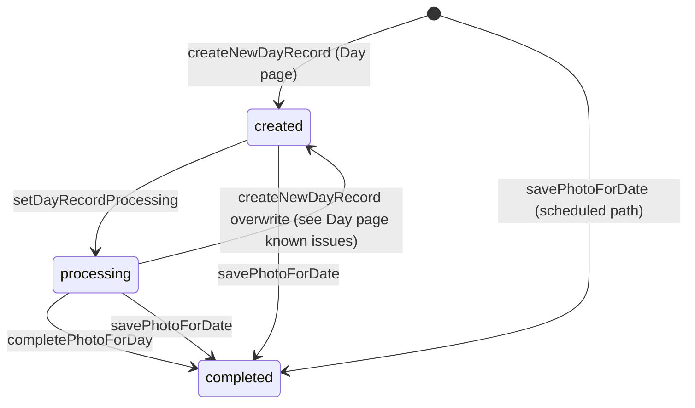

# Day assignment

Part of the [architecture overview](README.md).

## Purpose

Decides which photo each day shows. Day records are moved to `completed` by one of two paths: on demand when a visitor requests an empty day, or ahead of time by an hourly job. The slice also records every assigned photo in `photo-ids` so that it isn't used again.

## Entry points

| Entry                             | Trigger                                                                                | Code                                                                                        |
| --------------------------------- | -------------------------------------------------------------------------------------- | ------------------------------------------------------------------------------------------- |
| `onDayRecordCreated`              | Firestore `onDocumentCreated` on `days/{dayId}`. Uses the secret `UNSPLASH_CLIENT_ID`. | [find-photo-for-day-task.ts](../functions/src/tasks/find-photo-for-day-task.ts)             |
| `processAvailablePhotosScheduled` | Cloud Scheduler, `every 1 hours`, UTC, 512 MiB. Uses the secret `UNSPLASH_CLIENT_ID`.  | [process-available-photos-task.ts](../functions/src/tasks/process-available-photos-task.ts) |
| `recordPhotoIdOnDayWrite`         | Firestore `onDocumentWritten` on `days/{dayId}`                                        | [record-photo-id-task.ts](../functions/src/tasks/record-photo-id-task.ts)                   |
| `processPhotoForDay()`            | Library code                                                                           | [photo-processor.ts](../functions/src/photo-processor.ts)                                   |

## Data

| Data                                                 | Access         | Notes                                                                              |
| ---------------------------------------------------- | -------------- | ---------------------------------------------------------------------------------- |
| `days/{YYYY-MM-DD}`                                  | Reads, writes  | The [Day page](day-page.md) creates placeholder records; this slice fills them in. |
| `photo-ids/{photoId}`                                | Writes (owner) | Empty documents. The only record of which photos have been used.                   |
| `available-photo-ids/{photoId}`                      | Reads, deletes | Filled by [Photo ingestion](photo-ingestion.md)                                    |
| `config/config`: `lastPage`                          | Reads, writes  | Shared with Photo ingestion                                                        |
| `config/config`: `processLimit`, `processingMinDate` | Reads          | IDs taken from the queue per run, and the earliest date to backfill                |

`DayRecord` ([types/day.ts](../functions/src/types/day.ts)):

| Field       | Type                                       |
| ----------- | ------------------------------------------ |
| `id`        | `YYYY-MM-DD` (document ID)                 |
| `photo`     | `UnsplashPhoto \| null`                    |
| `status`    | `'created' \| 'processing' \| 'completed'` |
| `createdAt` | `Timestamp`                                |
| `updatedAt` | `Timestamp`                                |

## Day record lifecycle

Functions that write `days` ([day-storage.ts](../functions/src/storage/day-storage.ts)):

| Function                 | Write              | Effect                                                                                       |
| ------------------------ | ------------------ | -------------------------------------------------------------------------------------------- |
| `createNewDayRecord`     | `set` (overwrites) | Sets `status: 'created'` and `photo: null`                                                   |
| `setDayRecordProcessing` | `update`           | Sets `status: 'processing'`                                                                  |
| `completePhotoForDay`    | `update`           | Sets `photo` and `status: 'completed'`                                                       |
| `savePhotoForDate`       | `set` (overwrites) | Writes a completed record. Creates the document if it doesn't exist, and resets `createdAt`. |

## Path A: on demand

1. The [Day page](day-page.md) creates `days/{date}` with `status: 'created'`.
2. `onDayRecordCreated` runs only if the new document's status is `created`. It sets the status to `processing` and calls `processPhotoForDay(dayId, 10)`.
3. Each attempt of `processPhotoForDay`:
   1. Fetches search page `config.lastPage` and advances `config.lastPage`. This uses up one search page per attempt, even when the attempt succeeds.
   2. Takes the first result that isn't in `photo-ids` and calls `get()` for its full details. If that call fails, it tries the next result.
   3. Calls `completePhotoForDay()` and returns `true`.
4. Failed attempts wait with exponential backoff: 1 s, 2 s, 4 s, 8 s, then 10 s for each attempt after that. After 10 attempts it returns `false`.

## Path B: scheduled pre-fill

1. Takes up to `config.processLimit` IDs from `available-photo-ids`.
2. Builds a list of target dates whose record is missing or not `completed`. Records in `created` or `processing` count as needing a photo.
   1. It first checks today through today + 29 days.
   2. Only if all 30 of those days are completed does it check `config.processingMinDate` through yesterday.
3. Handles each ID in turn, until it runs out of target dates:
   - **Already in `photo-ids`:** deletes the ID from the queue.
   - **Otherwise:** calls `get()`, then `savePhotoForDate(nextTargetDate)`, then deletes the ID from the queue.
   - **`get()` throws `NotFoundError`:** deletes the ID from the queue and continues.
   - **Any other error:** re-thrown, which ends the run.

When `savePhotoForDate` creates a document, `onDayRecordCreated` fires. It does nothing, because the status is already `completed`.

## Recording used photos

`recordPhotoIdOnDayWrite` runs on every write to `days`. When `after.photo.id` exists and is different from `before.photo?.id`, it writes `photo-ids/{photoId}`. Deletes are ignored.

## Invariants and contracts

- **A completed day keeps its photo.** No production code reassigns a completed day. `updatePhotoForDay` exists but is only called from tests.
- **The Day page must create records with `status: 'created'` and `photo: null`.** That is what starts Path A.
- **Each photo should be used at most once, but this is best effort.** `photo-ids` is written after the assignment, by a trigger, so there are gaps:
  - Checking `photo-ids` and assigning a photo is not transactional. Two paths running at the same time can pick the same ID before either one is recorded.
  - Path B can overwrite a day that Path A is still filling, because `created` and `processing` both count as "needs photo". The later write wins, and both IDs are marked as used.
  - If `recordPhotoIdOnDayWrite` fails, the error is logged and swallowed. The photo is then never marked as used and can be assigned again.

## Failure modes

| Failure                                         | Behavior                                                                                                                                             |
| ----------------------------------------------- | ---------------------------------------------------------------------------------------------------------------------------------------------------- |
| Path A fails all 10 attempts, or throws         | The error is logged. The day stays in `processing` and is never retried by Path A. Path B fills it later, once the date is inside its search window. |
| Path B hits an error other than `NotFoundError` | The rest of the run is aborted. Photos already assigned in that run stay assigned.                                                                   |
| `config/config` is missing                      | Both paths throw.                                                                                                                                    |
| The queue is empty, or no dates need photos     | Path B logs this and returns.                                                                                                                        |

## Code and tests

- [photo-processor.ts](../functions/src/photo-processor.ts), [photo-processor.test.ts](../functions/src/photo-processor.test.ts)
- [find-photo-for-day-task.ts](../functions/src/tasks/find-photo-for-day-task.ts), [find-photo-for-day-task.test.ts](../functions/src/tasks/find-photo-for-day-task.test.ts)
- [process-available-photos-task.ts](../functions/src/tasks/process-available-photos-task.ts), [process-available-photos-task.test.ts](../functions/src/tasks/process-available-photos-task.test.ts)
- [record-photo-id-task.ts](../functions/src/tasks/record-photo-id-task.ts), [record-photo-id-task.test.ts](../functions/src/tasks/record-photo-id-task.test.ts)
- [day-storage.ts](../functions/src/storage/day-storage.ts), [day-storage.test.ts](../functions/src/storage/day-storage.test.ts)
- [photo-id-storage.ts](../functions/src/storage/photo-id-storage.ts) (no direct tests)
- Types: [day.ts](../functions/src/types/day.ts)
