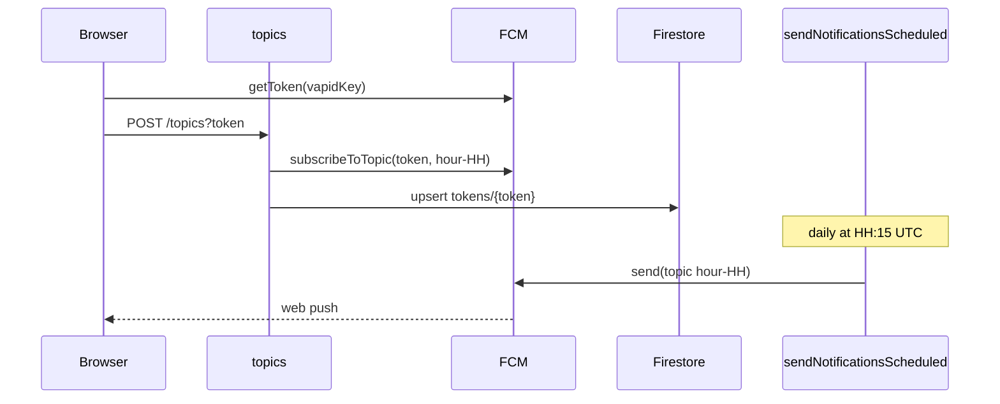

# Notifications

Part of the [architecture overview](README.md).

## Purpose

Opt-in daily web push. A visitor turns notifications on, and from then on gets one "Today's cat is ready to pounce!" notification a day, at roughly the local time they subscribed.

## Entry points

| Entry                        | Trigger                                                             | Code                                                                            |
| ---------------------------- | ------------------------------------------------------------------- | ------------------------------------------------------------------------------- |
| `initNotifications(app)`     | Every page load, from [src/index.ts](../src/index.ts)               | [src/notifications.ts](../src/notifications.ts)                                 |
| `#notifications-button`      | A click on the button                                               | [src/notifications.ts](../src/notifications.ts)                                 |
| Messaging service worker     | Push events while no page is in the foreground                      | [src/firebase-messaging-sw.ts](../src/firebase-messaging-sw.ts)                 |
| `topics`                     | HTTPS `POST` or `DELETE /topics?token=<fcm>`, via a Hosting rewrite | [topics-task.ts](../functions/src/tasks/topics-task.ts)                         |
| `sendNotificationsScheduled` | Cloud Scheduler, `15 * * * *`, UTC                                  | [send-notifications-task.ts](../functions/src/tasks/send-notifications-task.ts) |

## Data

| Data                                       | Where          | Notes                                                                                                   |
| ------------------------------------------ | -------------- | ------------------------------------------------------------------------------------------------------- |
| `tokens/{token}`                           | Firestore      | Owned by this slice. Fields: `token`, `topics: string[]`, `createdAt`, `updatedAt`.                     |
| FCM topics `hour-00` to `hour-23`          | FCM            | Each token is subscribed to the topic for the UTC hour in which it subscribed.                          |
| `notification_token`, `notification_topic` | `localStorage` | The client's view of whether it is subscribed                                                           |
| VAPID key, Firebase web config             | Client bundle  | Public values, in [src/notifications.ts](../src/notifications.ts) and [src/config.ts](../src/config.ts) |

The `tokens` collection is only used to know which topics to unsubscribe from. Sending relies entirely on FCM topic fan-out.

## Client behavior

On load, `initNotifications`:

1. Is meant to stop if `isSupported()` is false (but see known issue 6) or if the button is missing. Otherwise it creates the messaging instance, registers `onMessage`, and un-hides the button.
2. Checks `isSubscribed()`: permission must be `granted` and `notification_token` must be set. If so, it refreshes the token with `getToken()`, stores the result, and shows the "on" icon.
3. If not subscribed, it checks again after 100 ms, because Chrome on mobile sometimes reports `default` instead of `granted`.
4. Legacy upgrade: a client that has a token but no `notification_topic` calls `subscribe()` again. The code marks this with "TODO: Delete this after July 2025".

On click:

| Situation                                      | Action          |
| ---------------------------------------------- | --------------- |
| Permission is not `granted`, or no local token | `subscribe()`   |
| Otherwise                                      | `unsubscribe()` |

`subscribe()` and `unsubscribe()` do the following:

| Step              | `subscribe()`                                                  | `unsubscribe()`                  |
| ----------------- | -------------------------------------------------------------- | -------------------------------- |
| 1                 | `Notification.requestPermission()`                             | `DELETE /topics?token=…`         |
| 2                 | `getToken({ vapidKey })`                                       | `deleteToken()`                  |
| 3                 | `POST /topics?token=…`                                         | Removes `notification_token`     |
| 4                 | Stores `notification_token` and `notification_topic = hour-HH` | Shows the "off" icon and a toast |
| 5                 | Shows the "on" icon and a success toast                        |                                  |
| Permission denied | An info toast                                                  | —                                |
| Any failure       | An error toast                                                 | An error toast                   |

Foreground messages: `onMessage` displays the notification through `registration.showNotification(title, { body, icon })`.

Background messages: the service worker calls `getMessaging(app)`, and the Firebase SDK displays the notification payload.

Toasts are shown with [src/toast.ts](../src/toast.ts) `showToast(message, type = 'info', duration = 3000)`, which writes into the server-rendered `#toast` element.

## Server behavior

**`topics`** ([topics-task.ts](../functions/src/tasks/topics-task.ts)):

- The `token` query parameter is required and must be at least 10 characters. Otherwise the response is 400.
- **POST**:
  1. Subscribes the token to `hour-HH`, where `HH` is the current UTC hour. If FCM doesn't report `successCount === 1`, the request fails with 500.
  2. Upserts `tokens/{token}`, merging the new topic into `topics` and keeping `createdAt`.
  3. Responds `200 { success, message, topics }`.
- **DELETE**:
  1. Returns 404 if `tokens/{token}` doesn't exist.
  2. Otherwise unsubscribes the token from each stored topic. A failure on one topic is logged and the rest continue.
  3. Deletes the document and responds `200 { success, message, unsubscribedTopics }`.
- Other methods get 405. Unexpected errors get 500.

**`sendNotificationsScheduled`** ([send-notifications-task.ts](../functions/src/tasks/send-notifications-task.ts)): at 15 minutes past each hour, it sends one FCM message to `/topics/hour-HH` for the current UTC hour.

- Title: `Daily Cat`
- Body: `Today's cat is ready to pounce!`
- Web push link: `https://daily.cat`

## Invariants and contracts

- **Timing:** a token gets one notification a day for each topic it holds, at `HH:15` UTC.
- **Fixed content:** the message is the same every day. It doesn't check whether today's day record is `completed`. A user who taps the notification lands on `/`, which can show the processing page.
- **No authentication:** `/topics` relies on the FCM token being hard to guess.

## Known issues

1. **Token rotation isn't propagated.** `isSubscribed()` stores whatever `getToken()` returns but never posts it to `/topics`. If FCM rotates the token:
   - The new token isn't subscribed to any topic, so notifications stop silently.
   - The DELETE on unsubscribe returns 404 for the new token. `unsubscribe()` throws, shows an error toast, and the button stays "on".
2. **`unsubscribe()` leaves `notification_topic` in storage.**
3. **A token can end up with two topics.** The server merges topics, so a token that subscribes in two different UTC hours gets two notifications a day. This can happen through the legacy upgrade path or after site storage is cleared while permission is kept.
4. **Stale tokens are never pruned**, either from `tokens` or from FCM topics.
5. **Leftover code.** `getHoursUntilNextNotification()` is exported and tested but never used, and it assumes a single 00:15 UTC send. The legacy upgrade path is past its own "delete after July 2025" TODO.
6. **The support check never fails.** `isSupported()` from `firebase/messaging` returns a `Promise<boolean>`, and the code checks it without `await`. A Promise is always truthy, so the check never stops initialization. On browsers without push support, `getMessaging()` can throw instead.

## Code and tests

- [src/notifications.ts](../src/notifications.ts), [src/notifications.test.ts](../src/notifications.test.ts)
- [src/firebase-messaging-sw.ts](../src/firebase-messaging-sw.ts), [src/firebase-messaging-sw.test.ts](../src/firebase-messaging-sw.test.ts)
- [src/toast.ts](../src/toast.ts), [src/toast.test.ts](../src/toast.test.ts)
- [topics-task.ts](../functions/src/tasks/topics-task.ts), [topics-task.test.ts](../functions/src/tasks/topics-task.test.ts)
- [send-notifications-task.ts](../functions/src/tasks/send-notifications-task.ts), [send-notifications-task.test.ts](../functions/src/tasks/send-notifications-task.test.ts)
- [token-storage.ts](../functions/src/storage/token-storage.ts), [token-storage.test.ts](../functions/src/storage/token-storage.test.ts)
- Types: [token.ts](../functions/src/types/token.ts)
