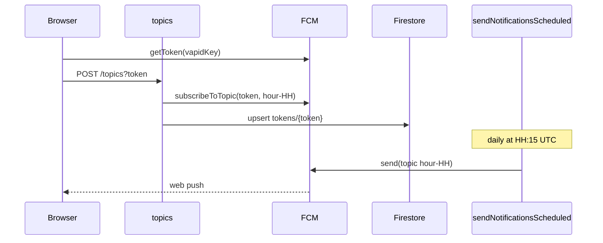

# Notifications

Part of the [architecture overview](README.md).

## Purpose

Opt-in daily web push. A visitor turns notifications on, and from then on gets one "Today's cat is ready to pounce!" notification a day, at roughly the local time they subscribed.

## Entry points

| Entry                        | Trigger                                                             | Code                                                                                    |
| ---------------------------- | ------------------------------------------------------------------- | --------------------------------------------------------------------------------------- |
| `initNotifications(app)`     | Every page load, from [src/index.ts](../src/index.ts)               | [src/notifications.ts](../src/notifications.ts)                                         |
| `#notifications-button`      | A click on the button                                               | [src/notifications.ts](../src/notifications.ts)                                         |
| Messaging service worker     | Push events while no page is in the foreground                      | [src/firebase-messaging-sw.ts](../src/firebase-messaging-sw.ts)                         |
| `topics`                     | HTTPS `POST` or `DELETE /topics?token=<fcm>`, via a Hosting rewrite | [topics-task.ts](../functions/src/notifications/topics-task.ts)                         |
| `sendNotificationsScheduled` | Cloud Scheduler, `15 * * * *`, UTC                                  | [send-notifications-task.ts](../functions/src/notifications/send-notifications-task.ts) |
| `pruneTokensScheduled`       | Cloud Scheduler, `every 24 hours`, UTC                              | [prune-tokens-task.ts](../functions/src/notifications/prune-tokens-task.ts)             |

## Data

| Data                                       | Where          | Notes                                                                                                                                                                                              |
| ------------------------------------------ | -------------- | -------------------------------------------------------------------------------------------------------------------------------------------------------------------------------------------------- |
| `tokens/{token}`                           | Firestore      | Owned by this slice. Fields: `token`, `topics: string[]` (one topic), `createdAt`, `updatedAt`. `updatedAt` is when the server last confirmed the token: a subscribe, or a successful prune check. |
| FCM topics `hour-00` to `hour-23`          | FCM            | Each token is subscribed to exactly one topic: the UTC hour in which it first subscribed.                                                                                                          |
| `notification_token`, `notification_topic` | `localStorage` | The client's view of whether it is subscribed, and to which hour                                                                                                                                   |
| `notification_synced_token`                | `localStorage` | The token the server last confirmed. When it differs from the current token, the client registers again.                                                                                           |
| VAPID key, Firebase web config             | Client bundle  | Public values, in [src/notifications.ts](../src/notifications.ts) and [src/config.ts](../src/config.ts)                                                                                            |

The `tokens` collection is only used to know which topics to unsubscribe from. Sending relies entirely on FCM topic fan-out.

## Client behavior

On load, `initNotifications`:

1. Stops if `await isSupported()` is false or if the button is missing. Otherwise it creates the messaging instance, registers `onMessage`, and un-hides the button.
2. Checks `isSubscribed()`: permission must be `granted` and `notification_token` must be set. If so, it refreshes the token with `getToken()`, syncs it (below), and shows the "on" icon.
3. If not subscribed, it checks again after 100 ms, because Chrome on mobile sometimes reports `default` instead of `granted`.

Syncing a token, when it differs from `notification_synced_token`:

1. `POST /topics?token=<new>&topic=<notification_topic>`, falling back to the current hour if no topic is stored. The user keeps their hour.
2. Stores the new token as both `notification_token` and `notification_synced_token`.
3. If the previous `notification_token` was different, which means FCM rotated it, sends `DELETE /topics?token=<old>`.
4. On failure it logs and keeps the old values, so the next page load tries again.

This also runs once for clients that subscribed before `notification_synced_token` existed. Their POST replaces any duplicate topics on the server.

On click:

| Situation                                      | Action          |
| ---------------------------------------------- | --------------- |
| Permission is not `granted`, or no local token | `subscribe()`   |
| Otherwise                                      | `unsubscribe()` |

`subscribe()` and `unsubscribe()` do the following:

| Step              | `subscribe()`                                                                      | `unsubscribe()`                                                                     |
| ----------------- | ---------------------------------------------------------------------------------- | ----------------------------------------------------------------------------------- |
| 1                 | `Notification.requestPermission()`                                                 | `DELETE /topics?token=…`. A 404 counts as success.                                  |
| 2                 | `getToken({ vapidKey })`                                                           | `deleteToken()`                                                                     |
| 3                 | `POST /topics?token=…&topic=hour-HH` for the current UTC hour                      | Removes `notification_token`, `notification_topic`, and `notification_synced_token` |
| 4                 | Stores `notification_token`, `notification_topic`, and `notification_synced_token` | Shows the "off" icon and a toast                                                    |
| 5                 | Shows the "on" icon and a success toast                                            |                                                                                     |
| Permission denied | An info toast                                                                      | —                                                                                   |
| Any failure       | An error toast                                                                     | An error toast                                                                      |

Foreground messages: `onMessage` displays the notification through `registration.showNotification(title, { body, icon })`.

Background messages: the service worker calls `getMessaging(app)`, and the Firebase SDK displays the notification payload.

Toasts are shown with [src/toast.ts](../src/toast.ts) `showToast(message, type = 'info', duration = 3000)`, which writes into the server-rendered `#toast` element.

## Server behavior

**`topics`** ([topics-task.ts](../functions/src/notifications/topics-task.ts)):

- The `token` query parameter is required and must be at least 10 characters. Otherwise the response is 400.
- **POST**:
  1. Uses the `topic` query parameter, which must match `hour-00` to `hour-23` (otherwise 400), or the current UTC hour if it's absent.
  2. Subscribes the token to that topic. If FCM doesn't report `successCount === 1`, the request fails with 500.
  3. Unsubscribes the token from every other topic stored for it. A failure on one topic is logged and the rest continue.
  4. Saves `tokens/{token}` with `topics: [topic]`, keeping `createdAt`.
  5. Responds `200 { success, message, topics, unsubscribedTopics }`.
- **DELETE**:
  1. Returns 404 if `tokens/{token}` doesn't exist.
  2. Otherwise unsubscribes the token from each stored topic. A failure on one topic is logged and the rest continue.
  3. Deletes the document and responds `200 { success, message, unsubscribedTopics }`.
- Other methods get 405. Unexpected errors get 500.

**`sendNotificationsScheduled`** ([send-notifications-task.ts](../functions/src/notifications/send-notifications-task.ts)): at 15 minutes past each hour, it sends one FCM message to `/topics/hour-HH` for the current UTC hour.

- Title: `Daily Cat`
- Body: `Today's cat is ready to pounce!`
- Web push link: `https://daily.cat`

**`pruneTokensScheduled`** ([prune-tokens-task.ts](../functions/src/notifications/prune-tokens-task.ts)): once a day, it checks up to 500 tokens whose `updatedAt` is more than 30 days old, oldest first.

1. Sends each one a dry-run message with `sendEach(messages, true)`. Nothing is delivered.
2. Tokens that fail with `messaging/registration-token-not-registered` or `messaging/invalid-registration-token` are dead. They are unsubscribed from their topics (grouped by topic, errors logged) and their documents are deleted.
3. Every other token, including ones that failed for another reason, gets `updatedAt` set to now, so it is checked again in 30 days.

Topic sends never report which tokens failed, so this check is the only way dead tokens leave `tokens` and the FCM topics.

## Invariants and contracts

- **Timing:** a token holds exactly one topic, so it gets one notification a day, at `HH:15` UTC.
- **Fixed content:** the message is the same every day. It doesn't check whether today's day record is `completed`. A user who taps the notification lands on `/`, which can show the processing page.
- **No authentication:** `/topics` relies on the FCM token being hard to guess.

## Known issues

None at the moment.

## Code and tests

The server side is in [functions/src/notifications/](../functions/src/notifications/). Its [index.ts](../functions/src/notifications/index.ts) exports only the `topics`, `sendNotificationsScheduled`, and `pruneTokensScheduled` functions.

- [src/notifications.ts](../src/notifications.ts), [src/notifications.test.ts](../src/notifications.test.ts)
- [src/firebase-messaging-sw.ts](../src/firebase-messaging-sw.ts), [src/firebase-messaging-sw.test.ts](../src/firebase-messaging-sw.test.ts)
- [src/toast.ts](../src/toast.ts), [src/toast.test.ts](../src/toast.test.ts)
- [topics-task.ts](../functions/src/notifications/topics-task.ts), [topics-task.test.ts](../functions/src/notifications/topics-task.test.ts)
- [send-notifications-task.ts](../functions/src/notifications/send-notifications-task.ts), [send-notifications-task.test.ts](../functions/src/notifications/send-notifications-task.test.ts)
- [prune-tokens-task.ts](../functions/src/notifications/prune-tokens-task.ts), [prune-tokens-task.test.ts](../functions/src/notifications/prune-tokens-task.test.ts)
- [token-storage.ts](../functions/src/notifications/token-storage.ts), [token-storage.test.ts](../functions/src/notifications/token-storage.test.ts)
- Types: [token.ts](../functions/src/notifications/token.ts)
