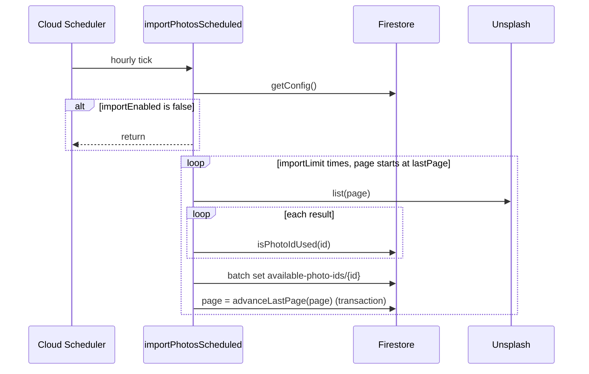

# Photo ingestion

Part of the [architecture overview](README.md).

## Purpose

Finds cat photos on Unsplash and queues the IDs of photos that haven't been used yet. [Day assignment](day-assignment.md) can then fill days from the queue without searching Unsplash itself. Visitors never see this slice directly.

## Entry points

| Entry                         | Trigger                                                                      | Code                                                                      |
| ----------------------------- | ---------------------------------------------------------------------------- | ------------------------------------------------------------------------- |
| `importPhotosScheduled`       | Cloud Scheduler, `every 1 hours`, UTC. Uses the secret `UNSPLASH_CLIENT_ID`. | [import-photos-task.ts](../functions/src/ingestion/import-photos-task.ts) |
| Unsplash client `list`, `get` | Library code. [Day assignment](day-assignment.md) calls it too.              | [cat-api.ts](../functions/src/ingestion/cat-api.ts)                       |

## Data

| Data                                            | Access         | Notes                                                                        |
| ----------------------------------------------- | -------------- | ---------------------------------------------------------------------------- |
| `available-photo-ids/{photoId}`                 | Writes (owner) | Empty documents; only the ID matters. Day assignment reads and deletes them. |
| `photo-ids/{photoId}`                           | Reads          | Owned by Day assignment. Checked with `isPhotoIdUsed()`.                     |
| `config/config`: `importEnabled`, `importLimit` | Reads          | Kill switch, and the number of pages to fetch per run                        |
| `config/config`: `lastPage`                     | Reads, writes  | Search page cursor, shared with Day assignment                               |

## Unsplash client

[cat-api.ts](../functions/src/ingestion/cat-api.ts) sends every request with the header `Authorization: Client-ID <UNSPLASH_CLIENT_ID>`.

| Function                     | Request                                                                                      | Returns          |
| ---------------------------- | -------------------------------------------------------------------------------------------- | ---------------- |
| `list({ clientId, page })`   | `GET https://api.unsplash.com/search/photos?query=cat&per_page=100&order_by=relevant&page=N` | `UnsplashSearch` |
| `get({ clientId }, photoId)` | `GET https://api.unsplash.com/photos/{photoId}`                                              | `UnsplashPhoto`  |

How non-2xx responses are reported:

| Response                                   | Thrown             |
| ------------------------------------------ | ------------------ |
| 404                                        | `NotFoundError`    |
| 403 with `Rate Limit Exceeded` in the body | `RateLimitedError` |
| Anything else                              | `Error`            |

No caller handles `RateLimitedError` differently from a generic error.

## Flow

## Invariants and contracts

- **The queue holds candidates, not reservations.** A queued ID can be used by the on-demand path after it is queued, so [Day assignment](day-assignment.md) checks `photo-ids` again before using it.
- **Imports are idempotent.** Entries are written with `set({})`, so importing the same page twice creates no duplicates.
- **The `lastPage` cursor is shared, and only moves forward.** Import and the on-demand path in Day assignment both advance it through Platform's `advanceLastPage()`, a transaction that never moves it backwards. Each caller then continues from the page it returns, so it skips pages the other caller already fetched. Two callers that start on the same page can still both fetch it. The used-ID checks make this harmless, but it wastes API quota.

## Failure modes

| Failure                                          | Behavior                                                                                                                                                                                  |
| ------------------------------------------------ | ----------------------------------------------------------------------------------------------------------------------------------------------------------------------------------------- |
| `config/config` is missing or fails the schema   | `getConfig()` throws and the run fails. The next hourly run tries again.                                                                                                                  |
| `UNSPLASH_CLIENT_ID` is empty                    | The run throws.                                                                                                                                                                           |
| A page fails (rate limit, network, or Firestore) | The error is logged and the loop moves on. `lastPage` has not been advanced, so the next iteration requests the same page again: a rate-limited run retries one page `importLimit` times. |
| `lastPage` is past the last search page          | `results` is empty. The run imports nothing but still advances `lastPage` on every pass.                                                                                                  |

## Code and tests

Everything is in [functions/src/ingestion/](../functions/src/ingestion/). Other slices import it only through [index.ts](../functions/src/ingestion/index.ts), which exports the Unsplash client, its types and errors, and the queue reads and deletes that Day assignment uses.

- [import-photos-task.ts](../functions/src/ingestion/import-photos-task.ts), [import-photos-task.test.ts](../functions/src/ingestion/import-photos-task.test.ts)
- [cat-api.ts](../functions/src/ingestion/cat-api.ts), [cat-api.test.ts](../functions/src/ingestion/cat-api.test.ts)
- [available-photo-ids-storage.ts](../functions/src/ingestion/available-photo-ids-storage.ts), [available-photo-ids-storage.test.ts](../functions/src/ingestion/available-photo-ids-storage.test.ts)
- Types: [unsplash.ts](../functions/src/ingestion/unsplash.ts), [errors.ts](../functions/src/ingestion/errors.ts)
- Fixtures: [functions/src/ingestion/fixtures/](../functions/src/ingestion/fixtures/)
